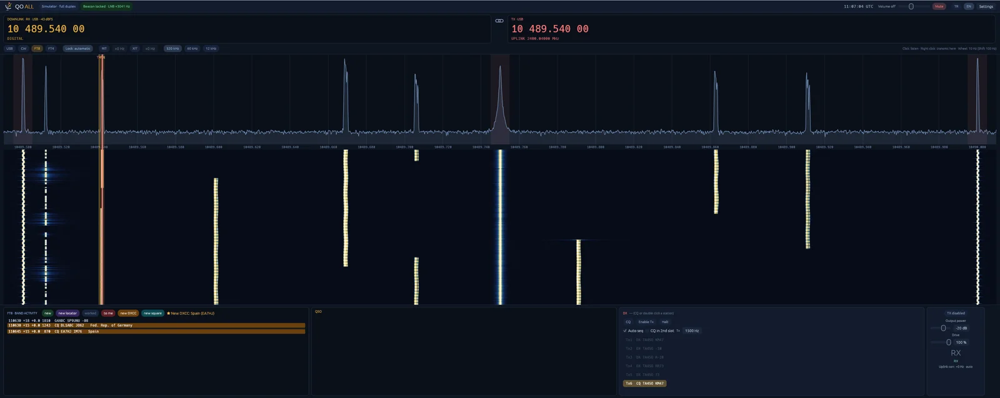
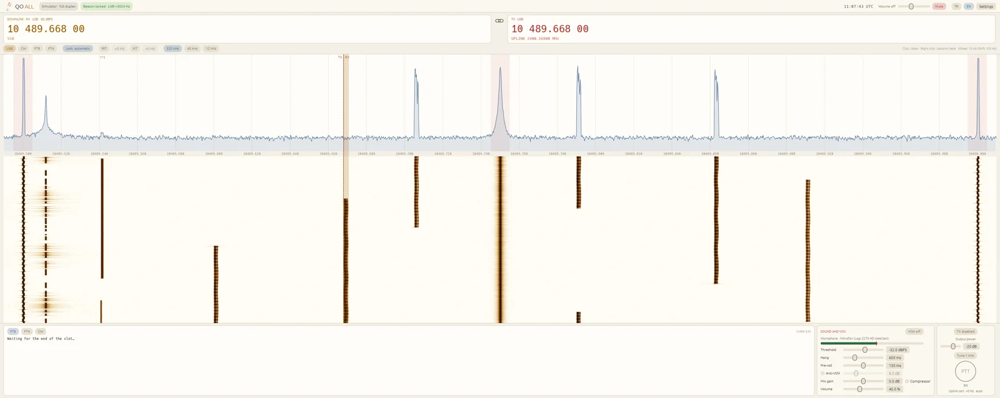

# QO-ALL

Full-duplex SSB, CW and FT8/FT4 transceiver for the narrow-band transponder of the QO-100
(Es'hail-2) geostationary satellite. Listen on 10 GHz and transmit on 2.4 GHz at the same
time with one ADALM-Pluto (or a similar AD936x radio over Ethernet or USB).

**Status: 0.7.1.** SSB, FT8, the beacon lock and the automatic uplink correction are in
use on the air with a Pluto on Ethernet; CW sending is new.
Windows (64-bit and 32-bit) and Linux (x86-64) packages.
Reports are welcome in the [issues](https://github.com/sozden/QO-ALL/issues). See the
[changelog](CHANGELOG.md) for what is in it and the known issues.

## Trying it

Windows: download `QO-ALL-<version>-windows-x64.zip` from the
[releases](https://github.com/sozden/QO-ALL/releases), unpack it and run `qo-all.exe`
(libiio and its libraries are in the package; on 32-bit Windows take
`QO-ALL-<version>-windows-x86.zip`). It starts on
the **simulator** (no radio needed): the transponder with beacons and some users, a
drifting LNB, and your own transmission coming back a quarter second later. Choose the
radio under Settings (e.g. `192.168.2.1`). `qo-all.exe --diagnose 192.168.2.1` prints
what the program finds without opening the window.

Linux (x86-64, Ubuntu 24.04 / Debian 13 or newer): download
`QO-ALL-<version>-linux-x64.tar.gz`, `sudo apt install libiio0 libasound2t64`, unpack it
and run `./qo-all`; `INSTALL.txt` has the udev rule for a Pluto on USB and the menu entry.

Transmitting is off until **TX enabled** is switched on, and stays inside the
narrow-band uplink, never on the beacons.

## What it does

- Spectrum and waterfall of the whole transponder (10489.500–10490.000 MHz); click a
  signal to listen (USB, CW), with automatic or manual lock; RIT and XIT
- Transmit on the listened frequency, or with a shift; uplink = downlink − 8089.5 MHz
- LNB drift corrected from the lower CW beacon
- **Automatic uplink correction**: your own transmission is found on the downlink
  (voice, tone or FT8) and the uplink moved so that it comes down where you listen
- Microphone and speaker selection, VOX for headsets (threshold, hang time, pre-roll,
  anti-VOX), PTT, compressor, output power, time-out timer, tune tone
- **CW sending**: a text box with ready messages, a straight key and an iambic paddle
  (mouse or keyboard: Space, [ and ]), speed in WPM, sidetone; the carrier on the dial
- **Drive** for FT8/FT4 and CW: the output level through the audio, as WSJT-X's Pwr
- **FT8 and FT4** in a WSJT-X-like panel: band activity, the contact's messages, Tx1–Tx6,
  CQ, Enable Tx / Halt, automatic sequencing from a CQ or an answer to the 73
- Finished contacts go into an **ADIF log** (QO-ALL's own, or shared with WSJT-X's
  `wsjtx_log.adi`), with the satellite fields LoTW expects (`PROP_MODE SAT`,
  `SAT_NAME QO-100`, 13cm/3cm). Decodes are coloured against the log: a new station's
  CQ green, a worked station from a new locator purple, worked ones dim, calls to you red;
  the country of each CQ is shown, and a new DXCC entity or grid square can be shown
  and/or sounded as an alert (country file cty.dat taken from WSJT-X or JTDX)
- **Log window**: the whole log (date, UTC, call, mode, reports, name, locator), scrolling
  with new contacts; SSB and CW contacts entered by hand into the same ADIF file, and any
  contact corrected with a double click
- **Radios**: ADALM-Pluto and LibreSDR (AD936x, libiio) to receive and transmit; an
  RTL-SDR on USB or over the network (rtl_tcp) and a HackRF One, receive only. Transmitting
  is used only with **TX enabled** ticked in the settings
- **Serial ports**: PTT out on DTR or RTS, a straight key or a paddle in on CTS/DSR
- The log always in view at the bottom; microphone and speaker chosen on the main screen
- **S-meter** (S units from the noise floor, S/N in dB), the level in dBm with a one-step
  calibration, and the band plan (CW, FT8, SSB, beacons) under the spectrum
- A Pluto on Ethernet runs at 0.6 MS/s with FIR filters in the radio (it takes only about
  5 MB/s); USB and gigabit radios such as the LibreSDR at 2.4 MS/s

## Building

Rust 2024 (`cargo build --release`). At run time libiio 0.x is needed (`libiio.dll` on
Windows, `libiio.so.0` on Linux).

## Heritage

The receiver, beacon lock, CW and FT8/FT4 decoders come from
[SeDiR](https://github.com/sozden/SeDiR). The FT8/FT4 code tables and message encoding
come from WSJT-X (GPL-3.0); see `tools/gen_ft8_tables.sh`.

## License

GPL-3.0-or-later.

---

# QO-ALL (Türkçe)

QO-100 (Es'hail-2) uydusunun dar bant transponderi için full duplex SSB ve FT8/FT4
alıcı-verici. Tek bir ADALM-Pluto (veya Ethernet/USB ile bağlı benzer AD936x cihaz) ile
10 GHz'de dinlerken aynı anda 2.4 GHz'de yayın yapılır.

**Durum: 0.7.1.** SSB, FT8, beacon kilidi ve otomatik uplink
düzeltmesi Ethernet'li Pluto ile yayında kullanılıyor; CW gönderimi yeni. Windows (64 ve
32 bit) ve Linux paketleri [sürümler](https://github.com/sozden/QO-ALL/releases) sayfasında;
Windows'ta açıp `qo-all.exe`'yi çalıştırmak yeterli, Linux'ta `INSTALL.txt`'ye bakın. Hata ve önerileri [issues](https://github.com/sozden/QO-ALL/issues)
bölümüne yazabilirsiniz; ayrıntılar [değişiklikler](CHANGELOG.md) dosyasında.

Program simülatörle açılır; cihaz Ayarlar'dan seçilir (ör. `192.168.2.1`). Yayın
"TX etkin" açılmadan yapılmaz ve yalnızca dar bant uplink içinde, beacon'lar dışında olur.

Özellikler: tüm transponderin spektrum ve şelalesi, tıklayarak dinleme (USB, CW),
otomatik/elle kilit, RIT ve XIT; dinlenen frekansta ya da shift ile yayın; beacon'dan LNB
düzeltmesi; kendi sinyalinden **otomatik uplink düzeltmesi**; mikrofon/hoparlör seçimi,
kulaklık için VOX, PTT, kompresör, çıkış gücü, zaman aşımı, ton; WSJT-X benzeri
**FT8/FT4** paneli (bant etkinliği, QSO, Tx1–Tx6, CQ, otomatik sıra); **CW gönderme**
(metin, hazır mesajlar, düz anahtar, iambik paddle, WPM, yan ton); FT8/FT4 ve CW için
**Drive**; yeni DXCC ve yeni lokatör için görsel/sesli uyarı (cty.dat WSJT-X/JTDX'ten); biten QSO'lar
**ADIF loguna** (QO-ALL'ın kendi ya da WSJT-X'in `wsjtx_log.adi` dosyası), LoTW'nin
istediği uydu alanlarıyla. Çözülen mesajlar loga göre renklenir: yeni istasyonun CQ'su
yeşil, çalışılmış istasyonun yeni lokatörü mor, çalışılmışlar soluk, size gelenler kırmızı.
**Log penceresi**: tüm log (tarih, UTC, çağrı, mod, raporlar, isim, lokatör) kayarak
izlenir; SSB ve CW QSO'ları aynı ADIF dosyasına elle girilir, her kayıt çift tıklamayla
düzeltilir. Tune düğmesi her modda (SSB'de 1 kHz ton).
**S-metre** (S birimleri gürültü tabanından, S/N dB olarak), tek adımda kalibre edilen
dBm seviyesi ve spektrumun altında bant planı (CW, FT8, SSB, beacon'lar).
Ethernet'li Pluto 0.6 MS/s (cihazda FIR filtresi); USB'de ve LibreSDR gibi gigabit
cihazlarda 2.4 MS/s.
**Cihazlar**: alma ve gönderme için ADALM-Pluto ve LibreSDR (AD936x); yalnızca alma için
USB ya da ağ (rtl_tcp) üzerinden RTL-SDR ve HackRF One. Yayın ancak ayarlarda **TX etkin**
işaretliyse yapılır (anten/SWR uyarısıyla). **Seri port**: DTR/RTS'den PTT çıkışı,
CTS/DSR'den düz anahtar ya da paddle girişi. Log her zaman ekranın altında; mikrofon ve
hoparlör ana ekranda, yeniden başlatmadan değişir.
